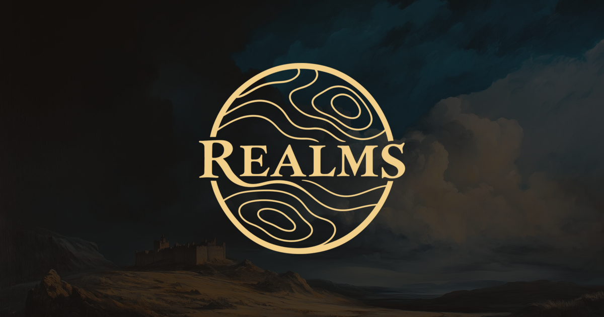

<p align="center">
  
</p>

<p align="center">
  Open-source, fully onchain strategy games by BibliothecaDAO.<br />
  <b><a href="https://play.realms.party">Play</a></b> ·
  <b><a href="https://docs.realms.party">Docs</a></b> ·
  <a href="https://discord.gg/realmsworld">Discord</a> ·
  <a href="https://x.com/LootRealms">X</a>
</p>

# Realms

Every move in Realms is a transaction on our own Starknet appchain: the contracts are the game, and the client draws
what the chain says. One codebase runs every format. A game is a row in a persistent world, created with an immutable
balance preset ([`config/source`](./config/source)), not a separate deployment. This repository holds the games, their
contracts and every service that runs them.

| Format       | What it is                                                                                                                                                                          |
| ------------ | ----------------------------------------------------------------------------------------------------------------------------------------------------------------------------------- |
| **Frontier** | A treasure hunt on a new map every day, free to play. Send armies into the fog, clear what guards the land and bring home Essence, labor and LORDS. Your realm keeps what it earns. |
| **Blitz**    | A 60-minute match of up to 24 players, entered in paid slots. Points come from exploring, opening crates, taking camps, rifts and Hyperstructures, and holding Hyperstructures.     |
| **Eternum**  | The long format: a world that unfolds over weeks of empire building, trade and war.                                                                                                 |

The rules of each are on [docs.realms.party](https://docs.realms.party).

## How it works

```
contracts/l3/world-native   Cairo contracts: the world and its rules
        │ signed player intents, randomness recorded in each play
        ▼
Madara sequencer            one appchain per shard (deploy/shard, deploy/athanor)
        │ blocks
        ▼
Herald (apps/herald)        folds confirmed blocks; streams snapshots and ordered diffs over one WebSocket
        │
        ▼
native fact store           packages/core: the client's one store of current game facts
        │
        ▼
three.js scenes + React UI  apps/game
```

Starknet mainnet holds what has value outside a game: the ledger (Blitz entries, Frontier withdrawals, prizes), MMR,
LORDS and the collectibles ([`contracts/l2`](./contracts/l2)). Sign-in, the shard directory and launches are Cloudflare
Workers.

## Repository layout

| Path                                                     | What                                                                                                                                         |
| -------------------------------------------------------- | -------------------------------------------------------------------------------------------------------------------------------------------- |
| [`apps/game`](./apps/game/README.md)                     | The game client: React, Vite, three.js                                                                                                       |
| [`apps/herald`](./apps/herald/README.md)                 | Reads the chain for clients: snapshots, ordered diffs, transaction outcomes                                                                  |
| [`apps/game-docs`](./apps/game-docs/README.md)           | docs.realms.party (Vocs)                                                                                                                     |
| `apps/realms`                                            | Identity Worker: sign-in, accounts, the shard directory, ratings, chat                                                                       |
| [`apps/launch-service`](./apps/launch-service/README.md) | Game launches and Blitz slots                                                                                                                |
| [`apps/value-relay`](./apps/value-relay/README.md)       | Ledger reads and payouts between the shards and Starknet                                                                                     |
| [`apps/agent-runner`](./apps/agent-runner/README.md)     | Runs one hired agent that plays through the game client                                                                                      |
| `apps/web`                                               | realms.world                                                                                                                                 |
| `apps/admin`, `guardian`, `status`, `status-monitor`     | The operator page, device-change approvals, the public status page and its monitor                                                           |
| `apps/indexer`, `apps/amm-indexer`                       | Starknet indexers: Realms, the bridge and veLORDS; the AMM                                                                                   |
| [`packages`](./packages/README.md)                       | Shared libraries: game logic and the sync runtime (`core`), types, chain, identity, provider                                                 |
| `contracts/l3`                                           | The appchain's contracts: the world, player accounts, the VRF verifier                                                                       |
| `contracts/l2`                                           | Starknet contracts: [ledger](./contracts/l2/ledger/README.md), MMR, tokens, collectibles, marketplace, [AMM](./contracts/l2/ammv2/README.md) |
| `config`                                                 | Balance sources, generated presets and the deployer                                                                                          |
| [`deploy`](./deploy/athanor/README.md)                   | Shards, environment setup and releases                                                                                                       |
| [`docs`](./docs/README.md)                               | A map of the repo's documentation, architecture notes and plans                                                                              |

Contributors start with [`AGENTS.md`](./AGENTS.md), the coding and review standard for the whole repo, and
[`CONTRIBUTING.md`](./CONTRIBUTING.md).

## Run it locally

You need Node.js 20.19 or later and pnpm 10.25. The contract checks and deploy scripts also use [Bun](https://bun.sh/).

```bash
git clone https://github.com/BibliothecaDAO/eternum.git
cd eternum
pnpm install --frozen-lockfile
pnpm run build:packages
```

**The game client** plays on the dev environment's shards: it signs in against them and lists their games. It needs your
own Alchemy endpoint for Starknet mainnet in `apps/game/.env.local` (gitignored); without one, the dev server refuses to
start.

```bash
echo 'VITE_PUBLIC_L2_RPC_URL=https://starknet-mainnet.g.alchemy.com/starknet/version/rpc/v0_9/<your-key>' > apps/game/.env.local
pnpm dev        # https://localhost:5173
```

**The docs site:** `pnpm dev:docs` (http://localhost:5173).

**The world contracts** need the Scarb and Starknet Foundry versions pinned in
[`.tool-versions`](./contracts/l3/world-native/.tool-versions). On Linux (x86_64 or aarch64), this installs them in
their own directory, leaving any other toolchain alone; the installer supports no other platform:

```bash
bash deploy/athanor/scripts/install-native-tools.sh "$HOME/.local/share/eternum-native-tools"
source "$HOME/.local/share/eternum-native-tools/env"
cd contracts/l3/world-native && scarb build
```

Their tests need a patched `snforge` ([`TOOLCHAIN.md`](./contracts/l3/world-native/TOOLCHAIN.md)), and
`bash contracts/l3/check-native.sh` is the full check before a contract change lands. Running a shard of your own
(Madara, Herald and the RPC) is covered in [`deploy/shard`](./deploy/shard/README.md) and
[`deploy/athanor`](./deploy/athanor/README.md).

## License

[MIT](./LICENSE)
